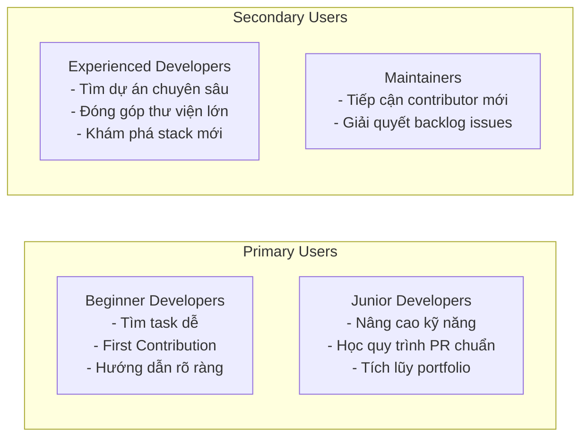
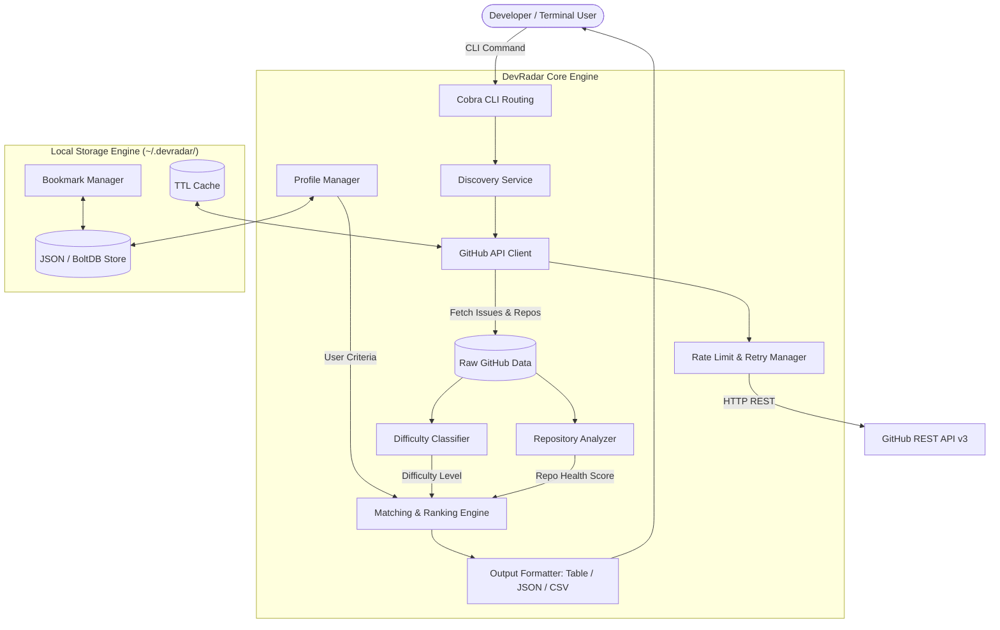
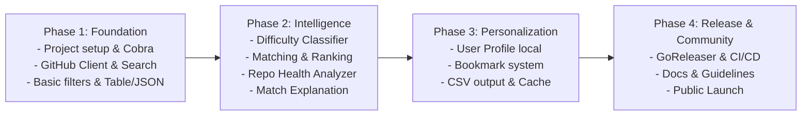

# DevRadar – Open Source Project Plan

> **Tagline**: Find your next Open Source contribution.  
> **Project Type**: Open Source CLI Tool  
> **Initial Platform**: GitHub  
> **Primary Language**: Go  
> **Proposed License**: MIT  
> **Document Version**: 1.0  
> **Status**: Planning & Technical Design Baseline  

---

## 1. Project Overview

### 1.1. Introduction
**DevRadar** là một công cụ dòng lệnh (CLI Tool) mã nguồn mở, độc lập và gọn nhẹ, được phát triển nhằm giúp lập trình viên (đặc biệt là người mới bắt đầu và trình độ sơ cấp/trung cấp) khám phá, phân tích, phân loại độ khó và tìm kiếm các GitHub Issues phù hợp với kỹ năng và mục tiêu đóng góp.

DevRadar kết nối trực tiếp với GitHub REST API v3, trích xuất dữ liệu issues và repository theo thời gian thực, sau đó áp dụng **Rule-based Classification Engine** để ước lượng độ khó và **Matching & Ranking Engine** theo công thức trọng số đa yếu tố nhằm đưa ra danh sách đề xuất tối ưu nhất.

### 1.2. Vision
Xây dựng một hệ sinh thái công cụ mã nguồn mở toàn diện giúp mọi developer trên thế giới vượt qua rào cản tâm lý và kỹ thuật để tự tin thực hiện những đóng góp (contributions) có giá trị cho cộng đồng Open Source.

### 1.3. Mission
1. **Giảm thiểu thời gian tìm kiếm**: Thay thế việc duyệt thủ công hàng trăm repository bằng một câu lệnh tìm kiếm tập trung.
2. **Khớp nối trình độ chính xác**: Đánh giá và lọc issues dựa trên kỹ năng thực tế, hạn chế tình trạng chọn task quá tầm hoặc quá đơn giản.
3. **Thúc đẩy First Contribution**: Hỗ trợ tối đa cho lập trình viên mới qua các bộ lọc nhãn (`good first issue`, `beginner-friendly`) và đánh giá độ rõ ràng của mô tả issue.
4. **Bảo vệ thời gian của contributor**: Phân tích hoạt động thực tế của repository để tránh lãng phí thời gian vào các dự án đã ngừng bảo trì (abandoned/inactive).
5. **Cộng đồng cùng phát triển**: Xây dựng kiến trúc mở, minh bạch, module hóa để mọi người đều có thể đóng góp tính năng mới.

### 1.4. Core Value Proposition
DevRadar không đơn thuần là một công cụ tìm kiếm từ khóa, mà còn là một **Decision Support Assistant** giúp giải quyết 5 câu hỏi then chốt:
1. *Issue nào phù hợp nhất với kỹ năng và ngôn ngữ của tôi?*
2. *Issue nào thực sự dễ tiếp cận cho người mới?*
3. *Repository này có còn active và maintainer có tích cực review PR không?*
4. *Issue này đã có người khác nhận làm chưa?*
5. *Tại sao DevRadar lại đề xuất Issue này (giải thích điểm số đề xuất rõ ràng)?*

---

## 2. Problem Statement

### 2.1. Current Problems
| ID | Vấn đề cốt lõi | Tác động thực tế |
| :--- | :--- | :--- |
| **P01** | Khó tìm repository phù hợp giữa hàng triệu dự án trên GitHub | Tốn nhiều giờ lướt GitHub Explore / Trending mà không tìm được task vừa sức |
| **P02** | Khối lượng Issues khổng lồ, phần lớn là bug phức tạp hoặc feature lớn | Gây choáng ngợp và hoang mang cho người mới tham gia Open Source |
| **P03** | Thiếu tiêu chuẩn thống nhất về độ khó giữa các tổ chức | Label `good first issue` đôi khi lại yêu cầu kiến thức chuyên sâu về internal architecture |
| **P04** | Rào cản tâm lý đối với First-time Contributor | Sợ gửi PR sai quy chuẩn, sợ bị từ chối do không nắm rõ quy trình |
| **P05** | Repository đã dừng hoạt động hoặc duy trì kém | Contributor gửi PR nhưng nhiều tháng không được maintainer review hay merge |
| **P06** | Issue đã được nhận nhưng chưa cập nhật assignee chính thức | Contributor tốn công làm việc rồi phát hiện đã có PR khác đang chờ merge |
| **P07** | Quy trình tìm kiếm và đánh giá hoàn toàn thủ công | Hiệu quả đóng góp thấp, dễ dẫn đến nản lòng và từ bỏ |

### 2.2. Proposed Solution
DevRadar cung cấp giải pháp toàn diện thông qua một CLI Tool:
- **Smart Discovery**: Tìm kiếm issues dựa trên query đa tiêu chí kết hợp API lọc chuyên sâu.
- **Difficulty Classification Engine**: Phân tích metadata, labels, độ dài văn bản, code snippet và lịch sử trao đổi để gán mức độ (Beginner / Intermediate / Advanced).
- **Multi-Factor Matching Engine**: Chấm điểm mức độ phù hợp từ 0–100 dựa trên trọng số kỹ năng, độ tươi mới và độ tin cậy.
- **Repository Health Checker**: Thẩm định tình trạng hoạt động (commit gần nhất, release gần nhất, tần suất tương tác).
- **Local Persistence & Bookmark**: Quản lý profile năng lực cá nhân và lưu vết các issues quan tâm hoàn toàn trên máy cục bộ (offline-first, zero-tracking).

---

## 3. Target Users & Personas



---

## 4. Product Scope & Capabilities

### 4.1. MVP Scope (Phase 1 & 2 Focus)
- **Global Discovery**: Tìm kiếm issues trực tiếp qua GitHub REST API mà không cần clone repository về local.
- **Advanced Filtering**: Lọc theo ngôn ngữ lập trình, danh sách labels, độ khó, trạng thái gán (assigned/unassigned), thời gian cập nhật, số lượng hiển thị.
- **Difficulty Classification (v1)**: Phân loại 3 cấp độ (Beginner, Intermediate, Advanced) sử dụng Rule-based Engine dựa trên nhãn chuẩn hóa và đặc tính issue.
- **Matching & Ranking (v1)**: Thuật toán tính điểm 6 yếu tố kèm theo lý do giải thích minh bạch (`Match Explanation`).
- **Repository Metadata**: Hiển thị thông số stars, forks, open issues, commit gần nhất, trạng thái archived.
- **Multiple Output Formats**:
  - Giao diện bảng Console trực quan với Lip Gloss (phối màu độ khó, thanh tiến trình điểm số).
  - Định dạng JSON chuẩn cho tích hợp pipeline script.
  - Định dạng CSV cho việc lưu trữ hoặc xuất báo cáo.
- **Local Profile & Bookmarks**: Lưu trữ profile kỹ năng và danh sách bookmark issues dưới dạng file cục bộ an toàn (`~/.devradar/`).
- **API Reliability**: Tích hợp cơ chế Rate-Limit monitor, cảnh báo quota, hỗ trợ cả Unauthenticated (60 req/h) và Personal Access Token (5,000 req/h).

### 4.2. Out of Scope for MVP
- Hỗ trợ GitLab, Bitbucket, Gitea (để dành cho Phase mở rộng đa provider).
- Phân tích mã nguồn repository local bằng AI/AST parser.
- Tự động assign issue hoặc tự động sinh Pull Request.
- Web Dashboard hoặc Cloud Sync (ưu tiên triết lý Local-first & Privacy-first).

---

## 5. Functional Requirements (FR)

### FR-01: Issue Discovery & Search
DevRadar cung cấp lệnh `devradar find` với các tùy chọn mạnh mẽ:
```bash
# Tìm kiếm cơ bản theo ngôn ngữ và trình độ
devradar find --language go --level beginner

# Lọc theo nhãn cụ thể và chỉ lấy issue chưa ai nhận
devradar find --label "good first issue" --unassigned --limit 15

# Tìm kiếm trong một tổ chức hoặc repo cụ thể
devradar find --org kubernetes --level intermediate
devradar find --repo gin-gonic/gin --unassigned

# Xuất kết quả dạng JSON hoặc CSV
devradar find --language python --level beginner --format json
devradar find --language rust --format csv > results.csv
```

**Business Rules:**
1. Luôn tự động gán điều kiện `is:issue is:open` để loại bỏ Pull Requests và Issues đã đóng.
2. Không trả về kết quả trùng lặp (deduplication theo Issue ID).
3. Hiển thị URL trực tiếp và thời gian cập nhật gần nhất dạng relative time (ví dụ: `2 hours ago`, `3 days ago`).

### FR-02: Difficulty Classification Engine
Phân loại issues thành 3 cấp bậc với cơ chế giải thích rõ ràng:

| Level | Định nghĩa | Dấu hiệu nhận biết điển hình |
| :--- | :--- | :--- |
| **Beginner** | Nhiệm vụ nhỏ, chỉnh sửa tài liệu, sửa lỗi chính tả, fix bug đơn giản, thêm test case nhỏ | Labels: `good first issue`, `documentation`, `easy`, `beginner`, `first-timers-only`. Text ngắn gọn, có hướng dẫn chi tiết. |
| **Intermediate** | Sửa bug cụ thể trong module, viết feature nhỏ, tối ưu query, thêm API endpoint | Labels: `bug`, `enhancement`, `help wanted`, `feature`. Cần hiểu kiến trúc một phần của codebase. |
| **Advanced** | Thay đổi core architecture, tối ưu performance sâu, bảo mật, xử lý concurrency | Labels: `architecture`, `performance`, `security`, `concurrency`, `breaking-change`, `core`. Thảo luận kỹ thuật phức tạp (>15 comments). |

### FR-03: Matching & Ranking Algorithm
Điểm phù hợp tổng thể được chuẩn hóa từ **0 đến 100 điểm**:

$$\text{Matching Score} = \sum (\text{Factor Score} \times \text{Weight})$$

$$\text{Total Score} = (S_{\text{skill}} \times 0.30) + (S_{\text{difficulty}} \times 0.25) + (S_{\text{freshness}} \times 0.15) + (S_{\text{repo\_activity}} \times 0.15) + (S_{\text{clarity}} \times 0.10) + (S_{\text{unassigned}} \times 0.05)$$

**Bảng trọng số:**
- **Skill Matching (30%)**: Khớp ngôn ngữ lập trình và framework yêu thích trong profile.
- **Difficulty Matching (25%)**: Khớp mức độ mong muốn của người dùng (`beginner`, `intermediate`, `advanced`).
- **Issue Freshness (15%)**: Thời gian từ lần cập nhật gần nhất (Mới cập nhật trong 7 ngày = 100 điểm, giảm dần theo thời gian).
- **Repository Activity (15%)**: Đánh giá dựa trên commit gần nhất (<30 ngày = 100 điểm, repo archived = 0 điểm).
- **Issue Clarity (10%)**: Đánh giá độ đầy đủ của mô tả (có code block, checklist, các bước tái hiện).
- **Unassigned Status (5%)**: Chưa có người gán xử lý được cộng tối đa điểm.

Mỗi kết quả trả về đều đi kèm chi tiết **Match Explanation**:
```text
Score: 92/100 [Excellent Match]
  • [30/30] Ngôn ngữ Go khớp hoàn toàn với profile
  • [25/25] Độ khó Beginner khớp với mong muốn (nhãn 'good first issue')
  • [15/15] Cập nhật 2 ngày trước (Active)
  • [13/15] Repository có commit trong 14 ngày qua
  • [05/05] Issue đang để trống assignee (Sẵn sàng tiếp nhận)
  • [04/10] Mô tả issue ở mức trung bình (không có checklist)
```

### FR-04: Repository Health Analysis
Đánh giá mức độ tin cậy của repository để đảm bảo công sức đóng góp không bị lãng phí:
- **Tình trạng lưu trữ (Archived)**: Cảnh báo ngay nếu repo ở chế độ Read-only.
- **Chu kỳ Release & Commit**: Repo không có commit trong 180 ngày sẽ bị giảm điểm nghiêm trọng.
- **Tỷ lệ phản hồi**: Số lượng open issues và forks để nhận diện mức độ quan tâm của cộng đồng.

### FR-05: User Profile Management
Lưu trữ profile cá nhân tại `~/.devradar/profile.json` không yêu cầu tài khoản đám mây:
```bash
# Khởi tạo hoặc cập nhật profile
devradar profile set --level beginner --languages go,python --interests backend,cli

# Xem profile hiện tại
devradar profile show

# Xóa profile để quay về chế độ tìm kiếm ẩn danh
devradar profile reset
```

### FR-06: Bookmark & Tracking
Quản lý các task đang lưu tâm:
```bash
devradar save https://github.com/gin-gonic/gin/issues/3421
devradar saved
devradar unsave 3421
```

### FR-07: Output Formats
- **Console Table (Mặc định)**: Sử dụng Lip Gloss và ANSI styling đẹp mắt trên Terminal.
- **JSON Format (`--format json`)**: Phù hợp cho việc pipe dữ liệu sang `jq` hoặc script tự động.
- **CSV Format (`--format csv`)**: Xuất danh sách để mở bằng Excel/Google Sheets.

---

## 6. Non-Functional Requirements (NFR)

| ID | Nhóm yêu cầu | Tiêu chuẩn kỹ thuật |
| :--- | :--- | :--- |
| **NFR-01** | **Performance** | Thời gian phản hồi lệnh tìm kiếm < 2 giây (với kết nối mạng tiêu chuẩn); sử dụng in-memory cache cho metadata repo. |
| **NFR-02** | **Reliability** | Tự động xử lý timeout (10s), retry với exponential backoff khi gặp lỗi mạng tạm thời hoặc 5xx từ GitHub. |
| **NFR-03** | **Security** | GitHub Personal Access Token được lưu tại file config với quyền bảo mật cao (`0600` trên Unix/macOS), không bao giờ log token ra màn hình. |
| **NFR-04** | **Privacy** | Thiết kế Privacy-first: Profile và Bookmark lưu hoàn toàn trên máy local, không thu thập telemetry hay thông tin cá nhân. |
| **NFR-05** | **Portability** | Biên dịch Zero-CGO (Pure Go), tạo ra binary độc lập chạy mượt mà trên Windows, macOS (Intel & Apple Silicon) và Linux. |
| **NFR-06** | **Maintainability** | Áp dụng Clean Architecture và chuẩn Standard Go Project Layout; phân tách rõ ràng giữa CLI, Domain Logic và External Adapters. |
| **NFR-07** | **Extensibility** | Thiết kế Interface `IssueProvider` cho phép mở rộng sang GitLab, Bitbucket hoặc Gitea trong tương lai mà không sửa đổi core ranking. |
| **NFR-08** | **Testability** | Bao phủ Unit Test > 80% cho các package trọng yếu (`classification`, `ranking`, `github`). Hỗ trợ Mock HTTP transport. |

---

## 7. System Architecture & Technical Stack

### 7.1. Technology Stack
- **Ngôn ngữ**: Go (>= 1.22)
- **CLI Framework**: [spf13/cobra](https://github.com/spf13/cobra) (Chuẩn công nghiệp cho CLI trong Go)
- **Terminal Styling**: [charmbracelet/lipgloss](https://github.com/charmbracelet/lipgloss)
- **Bảng biểu Console**: [charmbracelet/bubbles/table](https://github.com/charmbracelet/bubbles) hoặc `olekukonko/tablewriter`
- **HTTP Client**: Chuẩn `net/http` với Custom Transport (Rate-limit interceptor)
- **Local Storage**: Pure-Go JSON persistence hoặc `bbolt` (đảm bảo không phụ thuộc CGO/GCC trên Windows)
- **Build & CI/CD**: GoReleaser + GitHub Actions

### 7.2. High-Level Architecture Diagram


### 7.3. Project Directory Structure
```text
devradar/
├── cmd/
│   └── devradar/
│       └── main.go                  # Điểm khởi chạy chương trình (Entrypoint)
├── internal/
│   ├── app/                         # Khởi tạo dependency injection và app context
│   │   └── app.go
│   ├── cli/                         # Cobra commands definition
│   │   ├── root.go                  # Root command & global flags
│   │   ├── find.go                  # devradar find
│   │   ├── view.go                  # devradar view <issue-id>
│   │   ├── profile.go               # devradar profile [set|show|reset]
│   │   ├── bookmark.go              # devradar save / saved / unsave
│   │   ├── auth.go                  # devradar auth [set-token|status]
│   │   └── repo.go                  # devradar repo <owner/repo>
│   ├── github/                      # Tương tác với GitHub REST API
│   │   ├── client.go                # HTTP client wrapper
│   │   ├── search.go                # Xây dựng query và fetch issues
│   │   ├── repo.go                  # Fetch metadata repository
│   │   └── ratelimit.go             # Theo dõi quota và rate limit headers
│   ├── discovery/                   # Điều phối luồng tìm kiếm và tổng hợp
│   │   └── discovery.go
│   ├── classification/              # Đánh giá độ khó issue
│   │   ├── classifier.go
│   │   └── rules.go                 # Ma trận luật nhãn và phân tích nội dung
│   ├── ranking/                     # Thuật toán chấm điểm và xếp hạng
│   │   ├── ranker.go
│   │   └── factors.go               # Tính toán từng factor cụ thể
│   ├── repository/                  # Phân tích mức độ hoạt động của repo
│   │   └── analyzer.go
│   ├── profile/                     # Quản lý hồ sơ kỹ năng người dùng
│   │   ├── manager.go
│   │   └── profile.go
│   ├── storage/                     # Quản lý đọc/ghi file local
│   │   ├── file_store.go
│   │   └── cache.go
│   └── output/                      # Định dạng đầu ra
│       ├── table.go                 # Table với Lip Gloss styling
│       ├── json.go                  # JSON serializer
│       └── csv.go                   # CSV exporter
├── pkg/
│   └── models/                      # Các struct dữ liệu dùng chung
│       ├── issue.go
│       ├── repository.go
│       ├── profile.go
│       ├── filter.go
│       └── ranking.go
├── docs/
│   ├── architecture.md
│   └── usage_guide.md
├── .github/
│   ├── workflows/
│   │   ├── ci.yml                   # Lint, test và coverage
│   │   └── release.yml              # Tự động build release khi tag version
│   ├── ISSUE_TEMPLATE/
│   └── pull_request_template.md
├── .goreleaser.yaml                 # Cấu hình đa nền tảng cho GoReleaser
├── Makefile                         # Lệnh tắt build, test, lint
├── go.mod
├── go.sum
├── README.md
├── CONTRIBUTING.md
├── CODE_OF_CONDUCT.md
├── LICENSE                          # MIT License
└── CHANGELOG.md
```

---

## 8. Development Roadmap



### Phase 1 – Foundation (Nền tảng & Tìm kiếm cơ bản)
- Khởi tạo Go Module (`go.mod`), cấu trúc thư mục chuẩn.
- Cài đặt Cobra CLI root command và lệnh `devradar find`.
- Xây dựng GitHub API client:
  - Hỗ trợ Bearer Token qua header hoặc `GITHUB_TOKEN`.
  - Quản lý Rate Limit headers và cảnh báo người dùng.
  - Search Issue query builder (luôn gắn `is:issue is:open`).
- Tích hợp các cờ lọc: `--language`, `--label`, `--limit`, `--unassigned`.
- Xuất kết quả dạng bảng Console cơ bản và JSON.

### Phase 2 – Intelligence (Bộ máy phân loại & Xếp hạng)
- Cài đặt `DifficultyClassifier`:
  - Thiết lập bảng từ điển nhãn nhận diện độ khó.
  - Phân tích độ dài mô tả, checklist, số lượng thảo luận.
- Cài đặt `RepositoryAnalyzer`:
  - Kiểm tra trạng thái archived, số ngày kể từ commit cuối.
- Cài đặt `Matching & Ranking Engine`:
  - Tính điểm trọng số 6 thành phần.
  - Chuẩn hóa điểm số trong khoảng 0–100.
  - Sinh chuỗi giải thích lý do đề xuất (`Match Explanation`).
- Nâng cấp giao diện Console bằng Lip Gloss (phối màu badge và điểm số).

### Phase 3 – Personalization (Cá nhân hóa & Lưu trữ cục bộ)
- Cài đặt `storage` quản lý thư mục `~/.devradar/`.
- Cài đặt lệnh `devradar profile` (lưu ngôn ngữ, level, framework yêu thích).
- Liên kết kết quả tìm kiếm với User Profile tự động.
- Cài đặt lệnh `devradar save`, `devradar saved`, `devradar unsave` cho Bookmark.
- Hỗ trợ xuất định dạng CSV qua `--format csv`.
- Tích hợp in-memory/file cache có TTL để tiết kiệm lượt gọi GitHub API.

### Phase 4 – Community & Public Release
- Viết tài liệu toàn diện: `README.md`, `CONTRIBUTING.md`, `CODE_OF_CONDUCT.md`, `LICENSE` (MIT).
- Tạo issue templates và PR template cho cộng đồng GitHub.
- Cấu hình GitHub Actions CI (chạy test trên Ubuntu, Windows, macOS).
- Cấu hình GoReleaser để xuất bản binary tự động (archive tar.gz/zip cho các hệ điều hành, Homebrew tap, Scoop manifest).
- Phát hành phiên bản **DevRadar v1.0.0-MVP**.

---

## 9. Acceptance Criteria (Tiêu chí nghiệm thu MVP)

Một phiên bản DevRadar MVP được xác nhận hoàn thành khi thỏa mãn đầy đủ các điều kiện sau:
1. **Khả năng cài đặt & chạy độc lập**: Cài đặt và thực thi trơn tru trên cả 3 nền tảng: Linux, macOS và Windows mà không đòi hỏi cài thêm thư viện runtime phức tạp.
2. **Tương tác GitHub API ổn định**: Thực hiện tìm kiếm thành công cả khi không có token (rate limit 60 req/h) và khi có Personal Access Token (5,000 req/h).
3. **Phân biệt chuẩn xác Issue**: 100% kết quả trả về là GitHub Issues còn mở, tuyệt đối không lẫn Pull Request.
4. **Bộ lọc hoạt động chính xác**: Hoạt động trơn tru khi kết hợp nhiều cờ lọc đồng thời (`--language`, `--label`, `--unassigned`, `--level`).
5. **Độ khó & Điểm phù hợp**:
   - Mọi issue hiển thị đều được gán nhãn độ khó ước lượng (Beginner / Intermediate / Advanced).
   - Điểm Matching Score (0–100) được tính toán đúng công thức trọng số.
   - Có thể xem chi tiết lý do đề xuất của DevRadar.
6. **Định dạng linh hoạt**: Hỗ trợ đầy đủ 3 định dạng đầu ra: Table giao diện đẹp, JSON hợp lệ và CSV chuẩn.
7. **Xử lý lỗi tin cậy**: Bắt và hiển thị thông báo thân thiện khi gặp sự cố mất mạng, token hết hạn, hoặc vượt quá rate limit.
8. **Chất lượng mã nguồn**: Toàn bộ unit tests vượt qua thành công, kiến trúc module rõ ràng, mã nguồn tuân thủ tiêu chuẩn `gofmt` và `golangci-lint`.
9. **Tài liệu hướng dẫn đầy đủ**: Có README hướng dẫn cài đặt, tra cứu lệnh nhanh và ví dụ minh họa rõ ràng.

---

## 10. Risk Management & Mitigations

| Rủi ro kỹ thuật | Mức độ | Biện pháp giảm thiểu |
| :--- | :---: | :--- |
| **GitHub Rate Limit bị cạn kiệt nhanh** | Cao | Hướng dẫn người dùng cấu hình GitHub Token cá nhân; tích hợp local cache với TTL 15-30 phút cho metadata repo; hiển thị thanh cảnh báo quota còn lại sau mỗi lệnh tìm kiếm. |
| **Phân loại độ khó sai lệch (False Positive)** | Cao | Minh bạch hóa quy tắc: luôn nhấn mạnh đây là điểm ước lượng của thuật toán (AI/Rule estimation) chứ không phải nhãn chính thức của maintainer; hiển thị lý do chấm điểm để người dùng tự đối chiếu. |
| **Gặp phải repository đã "chết" (Unmaintained)** | Trung bình | Bộ lọc `RepositoryAnalyzer` tự động trừ điểm nặng hoặc loại bỏ các repository bị archived hoặc không có commit nào trong vòng 6 tháng. |
| **Người dùng trên Windows gặp khó khăn biên dịch CGO** | Trung bình | Sử dụng 100% Pure Go dependencies (không dùng `go-sqlite3` yêu cầu gcc; thay bằng pure JSON store hoặc pure Go embedded KV). |
| **Độ phủ contributor ban đầu thấp** | Trung bình | Thiết kế tài liệu `CONTRIBUTING.md` cực kỳ thân thiện với người mới; tự dùng chính DevRadar để gắn nhãn `good first issue` cho chính repo DevRadar. |

---

## 11. Next Steps

1. **Review & Approval**: Người dùng xem xét và phê duyệt kế hoạch triển khai.
2. **Environment Readiness**: Đảm bảo môi trường Go compiler sẵn sàng trên máy phát triển.
3. **Khởi tạo Codebase (Sprint 1 - Foundation)**:
   - Khởi tạo `go.mod` và bộ khung thư mục.
   - Viết các domain models (`pkg/models`).
   - Xây dựng HTTP client tương tác GitHub API (`internal/github`).
   - Hoàn thiện lệnh `devradar find` cơ bản với định dạng Table & JSON.
4. **Phát triển Trí tuệ Phân loại (Sprint 2 - Intelligence)**:
   - Viết bộ phân loại `DifficultyClassifier` và bộ chấm điểm `Ranker`.
   - Bổ sung `Match Explanation` và giao diện Lip Gloss.
5. **Cá nhân hóa & Hoàn thiện (Sprint 3 - Personalization & Community)**:
   - Viết Profile & Bookmark engine.
   - Viết tài liệu mở rộng và cấu hình GoReleaser.

