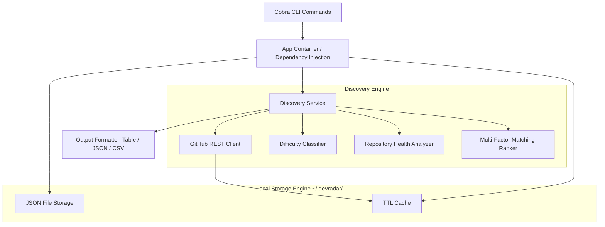

# DevRadar Architecture & Technical Design

## 1. Architectural Principles
DevRadar is built according to **Clean Architecture** principles and the standard Go project layout:
- **Zero External Daemon**: Runs purely as an offline-capable CLI binary without background daemons.
- **Pure Go (Zero CGO)**: Compiles cleanly across Linux, macOS, and Windows without GCC or C runtime dependencies.
- **Privacy First**: User profile and saved bookmarks reside strictly on local storage (`~/.devradar/`). Zero telemetry or external tracking.
- **Defensive Resilience**: Resilient against network jitter and API limits with exponential backoff and rate-limit headroom tracking.

## 2. Component Diagram

## 3. Package Responsibilities

| Package | Responsibility |
| :--- | :--- |
| `cmd/devradar` | Binary entrypoint and error exit handling. |
| `internal/cli` | Cobra commands, flags parsing, and user CLI interactions. |
| `internal/app` | App container, environment variable loading, dependency injection. |
| `internal/discovery`| High-level coordination between GitHub fetch, classification, analysis, and ranking. |
| `internal/classification` | Rule-based difficulty estimation (Beginner / Intermediate / Advanced). |
| `internal/repository` | Health assessment based on push recency, stars, and archived status. |
| `internal/ranking` | 6-factor normalized scoring (0–100) and rationale generation. |
| `internal/storage` | Local file persistence for configs, profiles, bookmarks, and cache. |
| `internal/output` | Lip Gloss console table rendering, JSON streaming, and CSV exports. |
| `pkg/models` | Core shared domain models and contracts. |

## 4. Multi-Factor Matching Formula

The matching algorithm computes a normalized score between 0 and 100:

$$\text{Total Score} = (S_{\text{skill}} \times 0.30) + (S_{\text{difficulty}} \times 0.25) + (S_{\text{freshness}} \times 0.15) + (S_{\text{repo\_activity}} \times 0.15) + (S_{\text{clarity}} \times 0.10) + (S_{\text{unassigned}} \times 0.05)$$

Each score factor is evaluated independently with transparent justification points returned in the `Match Explanation`.
